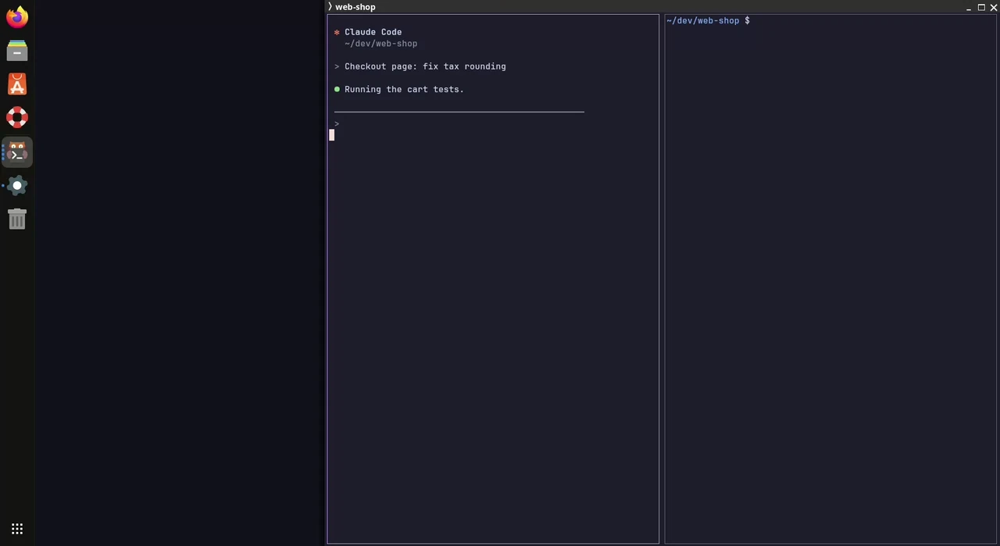
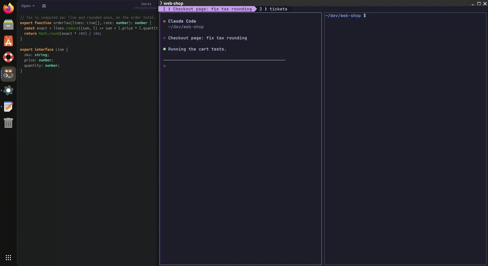

# revier

[](https://github.com/hk9890/revier/actions/workflows/ci.yml)
[](https://github.com/hk9890/revier/releases)
[](LICENSE)


A project-grouped control surface for running coding agents.


You run several projects at once. Each holds a coding agent, a shell, and the
things that belong with them — an editor, a diff viewer, a page. revier answers
the two questions that come up all day, in one keystroke each:

- Which of my agents is working, which is idle, and which one is waiting for me?
- Where is the editor for this project, and how do I get back to the terminal?

A *Revier* is a hunting ground or a patrolled district. Your projects are the
territory.

## Features

**Find the agent that needs you**

- **Popup on a desktop key.** The trigger key opens the TUI in its own kitty
  window, Alt+Space by default. The popup selects the project of the focused
  window and hides when you bring a window to the front.
  See [The popup](docs/user-guide/tui.md#the-popup).
- **All agents in one list.** In the popup, press the trigger key again to
  see every agent of every open project in one list. In a terminal, press
  alt+space. Agents that need you are on top, then working, idle and
  `unknown` agents. The project list shows each project with its agents
  counted by state. See [The agent list](docs/user-guide/tui.md#the-agent-list).
- **Jump to an agent.** Select an agent and press Enter. revier raises its
  tab and its window. The pane shows the agent's terminal as it is now.
  See [Move and act](docs/user-guide/tui.md#move-and-act).



**Open a project and its tools**

- **Search and open a workspace.** Type to fuzzy-filter the project list,
  then press Enter. revier opens the project's workspace as a kitty window or
  a tmux session, with its tabs, or raises it if it is open. From a shell,
  run `revier open demo`.
  See [Tabs](docs/user-guide/configuration.md#tabs).
- **One key per tool.** Give the editor, the ticket viewer or any other
  target its own key, for example Ctrl+Shift+O or Ctrl+Shift+T. A press opens
  the target or raises it. A second press returns you to the project's
  terminal workspace. A target declared in `config.toml` has the same key in
  every project.
  See [Go to a target and back](docs/user-guide/getting-started.md#go-to-a-target-and-back).
- **Windows placed for you.** On GNOME, revier opens, raises and places
  desktop windows through `wctl` from the
  [Window Control extension](https://github.com/carlo9890/gnome-window-control).
  `place = "right top 50% 100%"` sets where a new window goes.
  See [Realization fields](docs/user-guide/configuration.md#realization-fields).


**Stop and start again**

- **Shut everything down.** `revier shutdown` saves the session, then closes
  every open project. In the TUI, alt+s opens the sessions, and alt+q there
  shows the plan first. An agent that works or waits for you blocks the
  close until you add `--force`.
  See [Shut everything down](docs/user-guide/projects.md#shut-everything-down).
- **Restore a session.** `revier session restore` opens the saved projects
  and targets again. Each Claude Code agent resumes its conversation. After a
  full shutdown, the next TUI start offers the restore.
  See [Save and restore sessions](docs/user-guide/projects.md#save-and-restore-sessions).



**Reach further**

- **Projects on another machine.** `revier link buildbox far` adds a project
  on an ssh host as a row in your list. Its agents run on the host and show in
  your local terminal. In the TUI, press alt+r.
  See [Link a project](docs/user-guide/links.md#link-a-project).
- **Drive agents from a script.** `revier agent prompt`, `wait`, `read` and
  `send-keys` work with an agent, and none of them raises a window.
  See [Drive an agent from a script](docs/user-guide/agents.md#drive-an-agent-from-a-script).
- **Run one command in every project.** `revier each -- git pull --ff-only`
  runs the command in each project directory and prints the result for each.
  See [Run one command in every project](docs/user-guide/projects.md#run-one-command-in-every-project).

## Status

Early, but usable. Linux only.

- **Terminals:** kitty and tmux. Ghostty works through tmux.
- **Desktop:** GNOME, for window targets and desktop keys.
- **Agents:** Claude Code 2.1.212 or newer reports its state. opencode is
  recognised but reports no state. An external probe adds any other tool.
- **Commands:** every command in the
  [command line reference](docs/user-guide/cli.md).

To follow the design, read [docs/design/](docs/design/README.md) — it states
the model, its boundaries and the reasons, and logs the decisions behind it.

## Install

With [mise](https://mise.jdx.dev), which reads the releases page and puts
`revier` on your PATH:

```bash
mise use -g github:hk9890/revier
```

Or download an archive from the
[releases page](https://github.com/hk9890/revier/releases) and put `revier`
on your PATH. Archives are
named `revier_<version>_linux_<arch>.tar.gz`, with `x64` or `arm64` as the
architecture:

```bash
tar -xzf revier_<version>_linux_x64.tar.gz -C ~/.local/bin
```

`revier version` prints what is installed. To install from source instead,
see [Building](#building).

To verify an archive against the release's signed checksums, see
[Verify a download](docs/user-guide/getting-started.md#verify-a-download).

## First use

```bash
cd ~/dev/demo
revier new                     # write a project file for this directory
revier open                    # open its workspace: an agent beside a shell
revier keys install --dry-run  # see which desktop keys revier would claim
revier keys install            # claim the ones nothing else holds
revier                         # every project, its agent state, its targets
```

## User guide

The [user guide](docs/user-guide/README.md) covers the rest: getting started,
the concepts, the TUI and every key, projects, agents, projects on another
machine, the configuration reference, every command, troubleshooting,
statuses and agent probes, and how to set revier up with kitty, tmux, Ghostty,
GNOME, Claude Code and opencode.

## Building

Go 1.27, pinned with [mise](https://mise.jdx.dev).

```bash
mise install
mise run build     # ./bin/revier
```

Installing revier is [Install](#install) above.

To contribute, see [CONTRIBUTING.md](CONTRIBUTING.md).

## License

[MIT](LICENSE).
